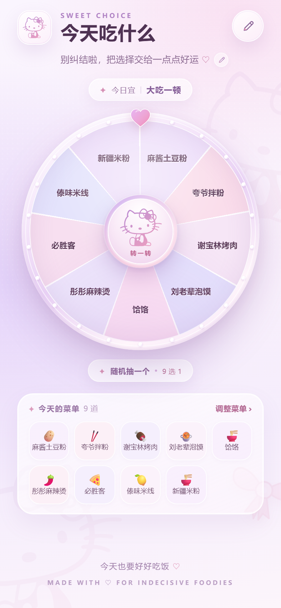
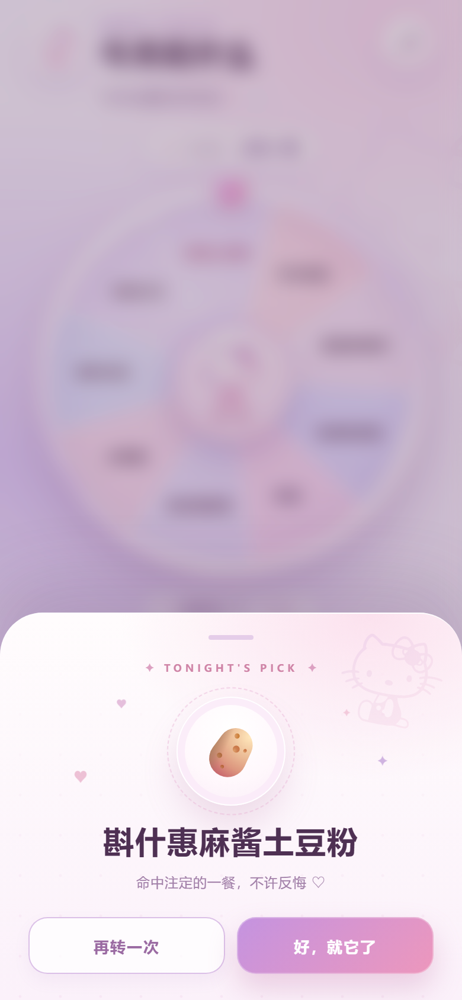
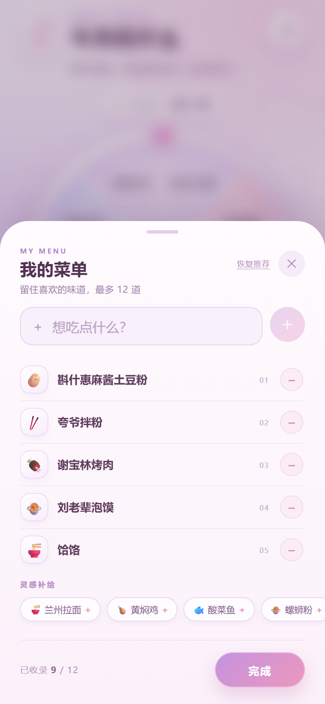
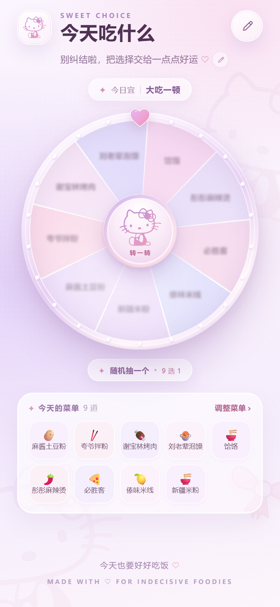
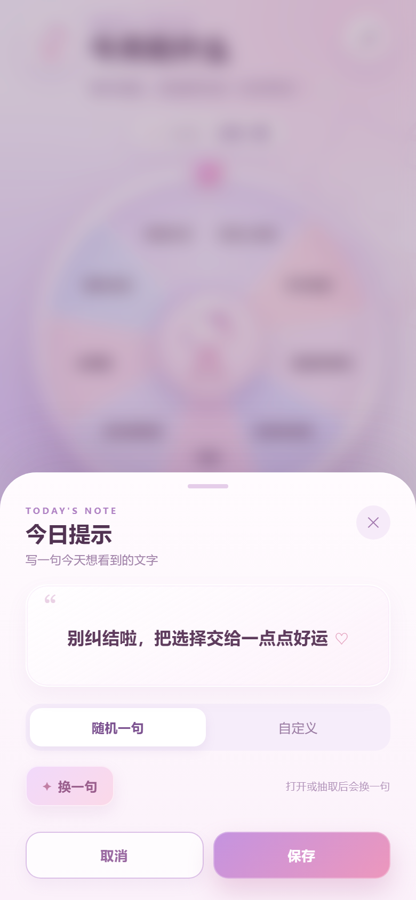
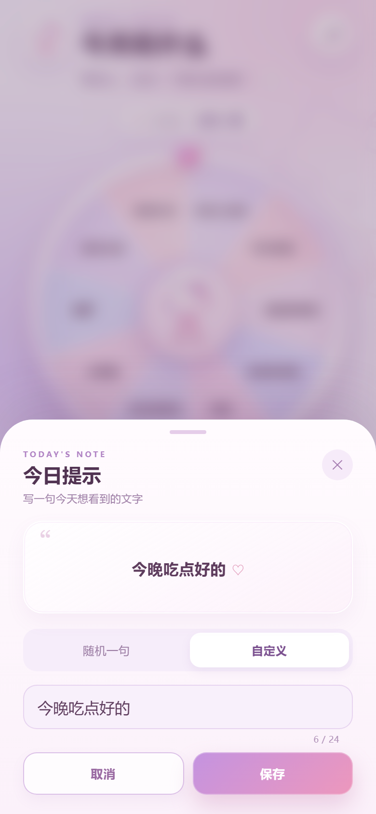

# 今天吃什么 · Sweet Choice

[](https://github.com/yhx-yhx/seven-food/actions/workflows/deploy.yml)

在线预览：**https://yhx-yhx.github.io/seven-food/**

一个纯 **Vue 3 + Vite** 的移动端美食转盘：浅紫 + 樱花粉的 Hello Kitty 风格，适合 iPhone / Android / H5。

默认内置 10 道菜，点中间 Kitty 或「随机抽一个」即可从当前菜单里随机选出今晚吃什么；菜单可以完全自定义，并保存在浏览器本地。



## 功能

- **随机抽一个**：从当前 10 道默认菜（或自定义菜单）中随机选择 1 道，转盘旋转 5～6 圈后缓慢停在结果扇形。
- **旋转中的标签**：旋转时标签轻微模糊，增加神秘感；同时标签始终水平朝上，随扇形位置移动，不会跟着转盘倒转。
- **今日提示**：顶部提示文字支持「随机一句」和「自定义」；随机模式每次打开、抽完一次或点「换一句」都会变化，自定义内容持久保存。
- **结果卡片**：底部弹出完整菜名、Emoji、庆祝动效；可「再转一次」或「好，就它了」。
- **自定义菜单**：默认 10 道菜、最多 12 道、最少 2 道；支持添加、删除、灵感推荐、恢复默认。
- **本地保存**：菜单和今日提示自动写入 `localStorage`，刷新/下次打开仍然保留。
- **移动端体验**：自适应 320～480px、安全区适配、`100dvh` 回退、iOS 输入框 16px 防缩放、遮罩滚动锁定、轻震动反馈、减少动效偏好支持。
- **原素材还原**：使用需求方提供的 Hello Kitty 线稿 SVG，改为浅紫 → 樱花粉渐变，保留原始造型。

| 抽取结果 | 编辑菜单 |
| --- | --- |
|  |  |

旋转过程中标签轻微模糊、始终水平：



今日提示支持随机 / 自定义：

| 随机一句 | 自定义 |
| --- | --- |
|  |  |

## 运行

```bash
npm install
npm run dev
```

开发地址：`http://localhost:5173/`

生产构建：

```bash
npm run build
npm run preview
```

`dist/` 即构建后的 H5 产物，可以部署到任意静态服务器。

> 用手机在同一局域网访问时，使用终端里显示的 Network 地址即可；项目已配置 `--host 0.0.0.0`。
> 若部署在子路径（如 `/food/`），请在 `vite.config.js` 里配置 `base: '/food/'`。

## 部署到 GitHub Pages

项目已配置 `base: './'` 和 GitHub Actions 工作流 `.github/workflows/deploy.yml`。

1. 推送到 `main` 分支。
2. 在仓库 `Settings → Pages → Build and deployment` 中把 Source 设为 **GitHub Actions**。
3. 等待 Actions 中的 `Deploy to GitHub Pages` 完成。
4. 访问 `https://<你的用户名>.github.io/<仓库名>/`。

> 如果 Pages 没有提前开启，Actions 可能提示找不到 Pages 站点；先在 Settings 里开启即可。
> 工作流使用 `npm ci` + `npm run build`，每次推送 `main` 都会自动更新线上版本。

## 兼容性

- iOS 15+ Safari / 微信内置浏览器
- Android Chrome / 系统 WebView（建议 Android 9+）
- 桌面 H5（480px 居中手机画幅）
- 使用了 `env(safe-area-inset-*)`、`100dvh`、`conic-gradient`、`backdrop-filter` 等现代 CSS，并做了必要回退；不支持 `conic-gradient` 的旧 WebView 会退化为单色转盘，功能仍可用。
- 纯前端、无后端、无第三方 UI 框架。

## 目录结构

```text
.
├─ docs/                     # 设计预览图
├─ src/
│  ├─ assets/
│  │  ├─ hello-kitty-line.svg  # 用户提供的原始线稿素材
│  │  └─ bow.svg               # 蝴蝶结原始素材
│  ├─ components/
│  │  ├─ HelloKitty.vue        # 内联 SVG 组件（着色用渐变）
│  │  └─ BowMark.vue           # 蝴蝶结组件
│  ├─ App.vue                  # 页面与全部交互逻辑
│  ├─ main.js
│  └─ style.css                # 全局重置、按钮、安全区
├─ index.html
├─ package.json
├─ vite.config.js
└─ dist/                       # 构建产物
```

## 自定义

### 修改默认菜品

编辑 `src/App.vue` 顶部的 `DEFAULT_FOODS`：

```js
const DEFAULT_FOODS = [
  { name: '斟什惠麻酱土豆粉', short: '麻酱土豆粉', emoji: '🥔' },
  // ...
]
```

- `name`：完整菜名，用于结果卡片和编辑列表
- `short`：转盘/菜单格子上的短名（建议 ≤ 6 个字符）
- `emoji`：菜品图标

### 今日提示文案

- 随机文案池：`src/App.vue` 顶部 `PROMPT_POOL`
- 自定义/随机模式与当前文案会写入 `localStorage`
- 存储 key：`sevenfood.prompt.v1`
- 页面顶部的提示文字本身可点击，或点右侧小铅笔进入设置

### 修改主题色

- 转盘扇形颜色：`src/App.vue` 中的 `PALETTE`
- 页面渐变/卡片颜色：`src/App.vue` 中 `.page`、`.wheel-shell`、`.hub` 等样式
- Hello Kitty 线条渐变：`src/components/HelloKitty.vue` 里的 `linearGradient`
- 蝴蝶结颜色：`src/components/BowMark.vue`

### 随机与存储

- 随机使用 `crypto.getRandomValues`（不可用时回退 `Math.random`），并避免连续两次抽到同一道菜。
- 菜单存储 key：`sevenfood.menu.v1`
- 提示存储 key：`sevenfood.prompt.v1`
- 清空存储：
  ```js
  localStorage.removeItem('sevenfood.menu.v1')
  localStorage.removeItem('sevenfood.prompt.v1')
  ```

## 打包成 App（可选）

项目本身是标准 H5，可以直接部署；若需要上架 iOS / Android，可把 `dist/` 交给 Capacitor / Cordova 等 WebView 壳工程加载，不需要改动 Vue 代码。

> Hello Kitty 图形素材由需求方提供，请在使用/分发前自行确认相关授权。
